# TÀI LIỆU PHÂN CHIA CHỨC NĂNG & SƠ ĐỒ HOẠT ĐỘNG, SƠ ĐỒ TUẦN TỰ (PHỤ TRÁCH: HƯƠNG)

> **Dự án:** BookStore  
> **Người phụ trách:** Hương  
> **Căn cứ phân công:** File `time-line.md` & Danh sách 20 chức năng ghi chú của dự án.  
> **Nguyên tắc kỹ thuật:** Bám sát 100% mã nguồn thực tế tại dự án gốc `BookStore` (Kiến trúc 3 lớp: Router → Controller → Service → Repository → Database PostgreSQL, tích hợp React Query, Zod validation, Transaction & Row-level Locking).

---

## PHẦN 1: BẢNG ĐỐI CHIẾU 20 MỤC GHI CHÚ VỚI PHÂN CÔNG CỦA HƯƠNG

Theo danh sách 20 mục trong bản ghi chú yêu cầu và bảng phân công tại `time-line.md`, toàn bộ dự án gồm 16 Module chia đều cho 2 thành viên (**Bình phụ trách 8 module** thiên về luồng mua hàng của khách; **Hương phụ trách 8 module** thiên về quản trị Admin và các tính năng tương tác chuyên sâu của người dùng).

| STT Ghi chú | Tên chức năng trong ghi chú | Phụ trách | Module tương ứng trong code | Vai trò & Phạm vi nghiệp vụ của Hương |
|:---:|---|:---:|:---:|---|
| **1** | Đăng ký tài khoản | Bình | Module 01 (Auth - F01) | *Bình phụ trách (Đăng ký OTP email, mật khẩu)* |
| **2** | Đăng nhập / Đăng xuất | Bình | Module 01 (Auth - F02) | *Bình phụ trách (JWT Refresh/Access token)* |
| **3** | **Quản lý thông tin cá nhân** | **HƯƠNG** | **Module 04 (User Profile - F08)** | Cập nhật hồ sơ (tên, sđt, avatar), đổi mật khẩu (thu hồi session), quản lý phiên đăng nhập/thiết bị, tổng quan tài khoản. |
| **4** | **Quản lý địa chỉ giao hàng** | **HƯƠNG** | **Module 04 (User Profile - F09)** | Sổ địa chỉ giao hàng: CRUD địa chỉ, quy định tối đa 10 địa chỉ/tài khoản, cơ chế khoá transaction và tự động duy trì duy nhất 1 địa chỉ mặc định. |
| **5** | Tìm kiếm sách | Bình | Module 03 (Catalog - F07) | *Bình phụ trách (Tìm kiếm full-text search, filter)* |
| **6** | **Danh mục & phân loại sách** | **HƯƠNG** & Bình | **Module 02 (Admin - F03)** & M03 | **Hương quản trị (Admin):** CRUD cây danh mục cha-con, tác giả, nhà xuất bản, thứ tự hiển thị.<br>*(Bình làm phần hiển thị phía khách hàng ở M03)*. |
| **7** | Xem danh sách sản phẩm | Bình | Module 03 (Catalog - F05) | *Bình phụ trách (Trang danh sách sách, phân trang)* |
| **8** | Xem chi tiết sách | Bình | Module 03 (Catalog - F06) | *Bình phụ trách (Trang chi tiết sách, thông tin bìa, giá)* |
| **9** | Giỏ hàng | Bình | Module 05 (Cart - F10) | *Bình phụ trách (Thêm, bớt, cập nhật số lượng)* |
| **10** | Đặt hàng / Checkout | Bình | Module 06 (Order - F11) | *Bình phụ trách (Tạo đơn hàng, giữ tồn kho)* |
| **11** | Thanh toán (COD, online) | Bình | Module 07 (Payment - F12) | *Bình phụ trách (Cổng thanh toán VNPay, COD)* |
| **12** | **Wishlist / Sách yêu thích** | **HƯƠNG** | **Module 09 (Wishlist - F14)** | Thêm/xóa sách yêu thích, kiểm tra trạng thái yêu thích, giới hạn danh sách tối đa 100 cuốn (`WISHLIST_MAX_ITEMS`), khoá user tránh race condition. |
| **13** | **Đánh giá & bình luận sách** | **HƯƠNG** | **Module 10 (Review - F15)** | Đánh giá 1-5 sao kèm bình luận; điều kiện chỉ được đánh giá sách đã mua và đơn có trạng thái `DELIVERED`; chỉnh sửa trong 30 ngày; cập nhật tự động điểm trung bình sách (`refreshBookRating`); Admin kiểm duyệt/ẩn đánh giá. |
| **14** | Mã giảm giá / Voucher | Bình | Module 11 (Voucher - F16) | *Bình phụ trách (Áp mã voucher, tính chiết khấu)* |
| **15** | **Khuyến mãi / Flash Sale** | **HƯƠNG** | **Module 12 (Flash Sale - F17)** | Quản lý khung giờ vàng: Admin tạo đợt Flash Sale (chống trùng lặp thời gian `assertNoOverlap`), gán sách + giá sale + giới hạn mỗi người (`perUserLimit`); Khách hàng xem đếm ngược thời gian và tỷ lệ bán. |
| **16** | Thông báo cho khách hàng | Bình | Module 13 (Notification - F18) | *Bình phụ trách (Hệ thống chuông, email thông báo)* |
| **17** | **Quản lý sách & tồn kho (Admin)** | **HƯƠNG** | **Module 02 (Admin Books & Inventory - F03)** | Quản lý danh mục sách, thêm/sửa sách, upload ảnh bìa; Quản lý kho: Nhập hàng (`IMPORT`), Điều chỉnh kiểm kê (`ADJUST`), ghi log biến động kho (`inventory_logs`), cảnh báo tồn kho thấp. |
| **18** | **Quản lý khách hàng & đơn hàng (Admin)** | **HƯƠNG** | **Module 08 (Admin Customer & Order - F13)** | Quản lý khách hàng (xem chi tiết chi tiêu, khoá/mở tài khoản, huỷ phiên tức thì); Quản lý đơn hàng (duyệt trạng thái `PENDING → CONFIRMED → SHIPPING → COMPLETED`, huỷ đơn `adminCancel` kèm hoàn tồn kho tự động và hoàn lượt voucher). |
| **19** | **Dashboard & báo cáo doanh thu (Admin)** | **HƯƠNG** | **Module 14 (Admin Dashboard & Reports - F19)** | Thống kê số liệu kinh doanh: KPI Cards (Doanh thu, Đơn hàng, Khách hàng, Sách bán), biểu đồ doanh thu theo thời gian, tỷ lệ đơn hàng, top 10 sách bán chạy; Xuất báo cáo đơn hàng định dạng CSV (UTF-8 BOM). |
| **20** | **AI gợi ý sách theo sở thích** *(ghi chú: "AI nhưng chưa rõ ràng")* | **HƯƠNG** | **Module 15 (AI Recommendations - Groq - F20)** | Hệ thống gợi ý sách cá nhân hoá: Form thiết lập sở thích đọc sách (`preferences`), popup Onboarding chào mừng, kết nối Groq Cloud API (mô hình LLaMA 3.3 70B), cache kết quả gợi ý vào DB, rate limit nút làm mới gợi ý.<br>*(Lưu ý: Chức năng Chatbox AI tư vấn bán hàng M16 do Bình phụ trách)*. |

---

## PHẦN 2: CHI TIẾT SƠ ĐỒ HOẠT ĐỘNG (ACTIVITY) & SƠ ĐỒ TUẦN TỰ (SEQUENCE) CHO TỪNG CHỨC NĂNG

---

### CHỨC NĂNG 1: QUẢN LÝ THÔNG TIN CÁ NHÂN & SỔ ĐỊA CHỈ (MODULE 04 - F08, F09)
*Tương ứng mục 3 & 4 trong ghi chú.*

#### 1.1. Sơ đồ Hoạt động (Activity Diagram) – Quản lý Hồ sơ & Sổ địa chỉ
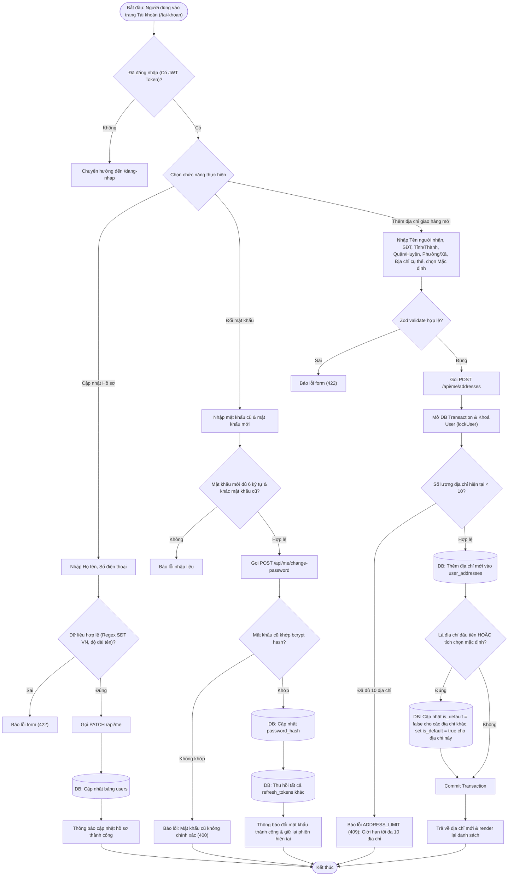

#### 1.2. Sơ đồ Tuần tự (Sequence Diagram) – Thêm địa chỉ mới có xử lý Transaction & Khóa người dùng
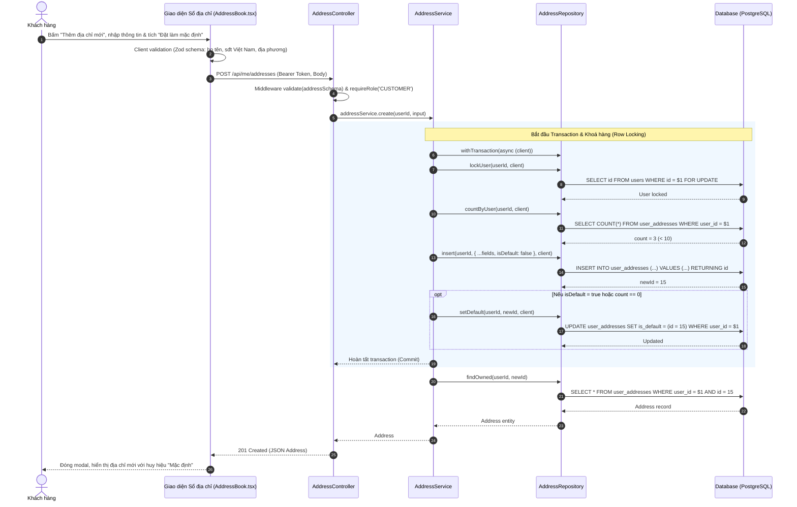

---

### CHỨC NĂNG 2: DANH SÁCH SÁCH YÊU THÍCH (WISHLIST) (MODULE 09 - F14)
*Tương ứng mục 12 trong ghi chú.*

#### 2.1. Sơ đồ Hoạt động (Activity Diagram) – Thêm / Xoá sách khỏi Wishlist
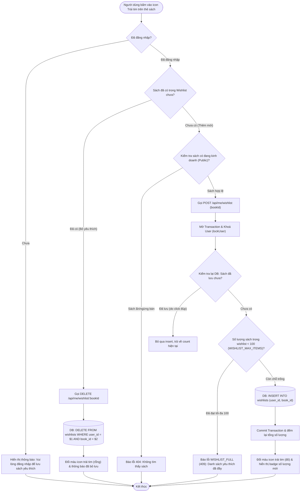

#### 2.2. Sơ đồ Tuần tự (Sequence Diagram) – Thêm sách vào Wishlist an toàn chống Race Condition
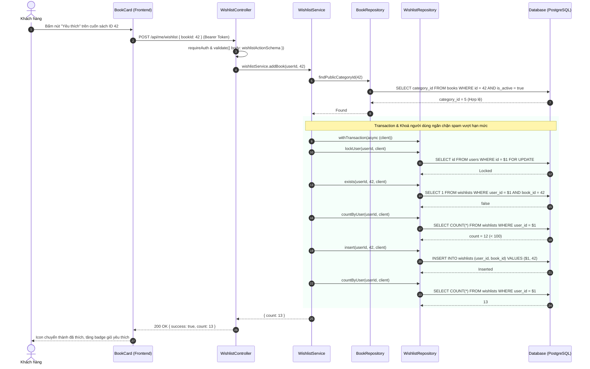

---

### CHỨC NĂNG 3: ĐÁNH GIÁ & BÌNH LUẬN SÁCH (MODULE 10 - F15)
*Tương ứng mục 13 trong ghi chú.*

#### 3.1. Sơ đồ Hoạt động (Activity Diagram) – Đánh giá sản phẩm đã mua
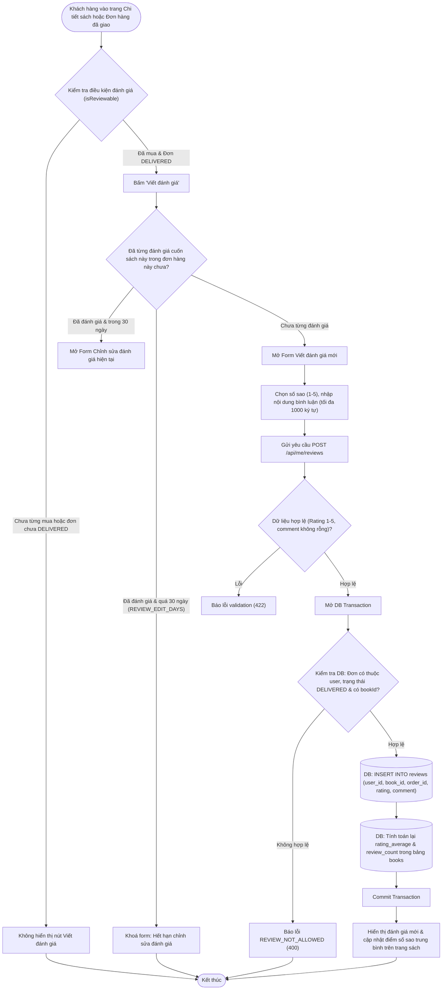

#### 3.2. Sơ đồ Tuần tự (Sequence Diagram) – Viết đánh giá và tính lại điểm xếp hạng của sách
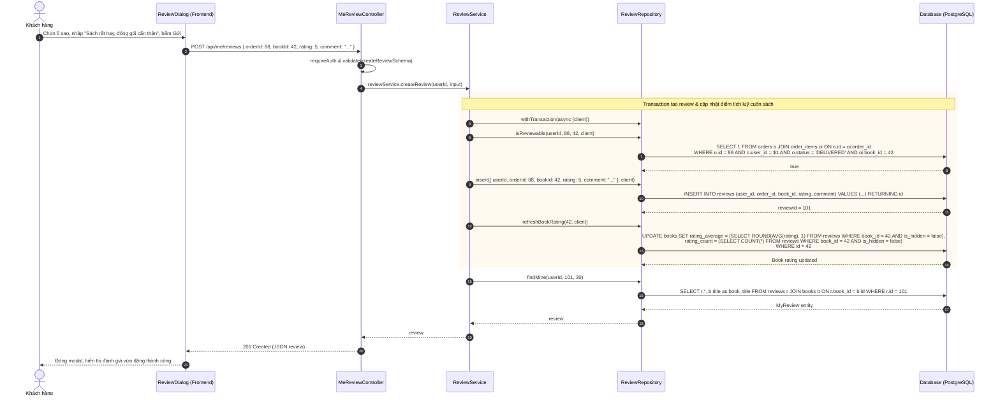

---

### CHỨC NĂNG 4: KHUYẾN MÃI & FLASH SALE (MODULE 12 - F17)
*Tương ứng mục 15 trong ghi chú.*

#### 4.1. Sơ đồ Hoạt động (Activity Diagram) – Tạo chiến dịch Flash Sale (Admin) & Mua hàng Flash Sale
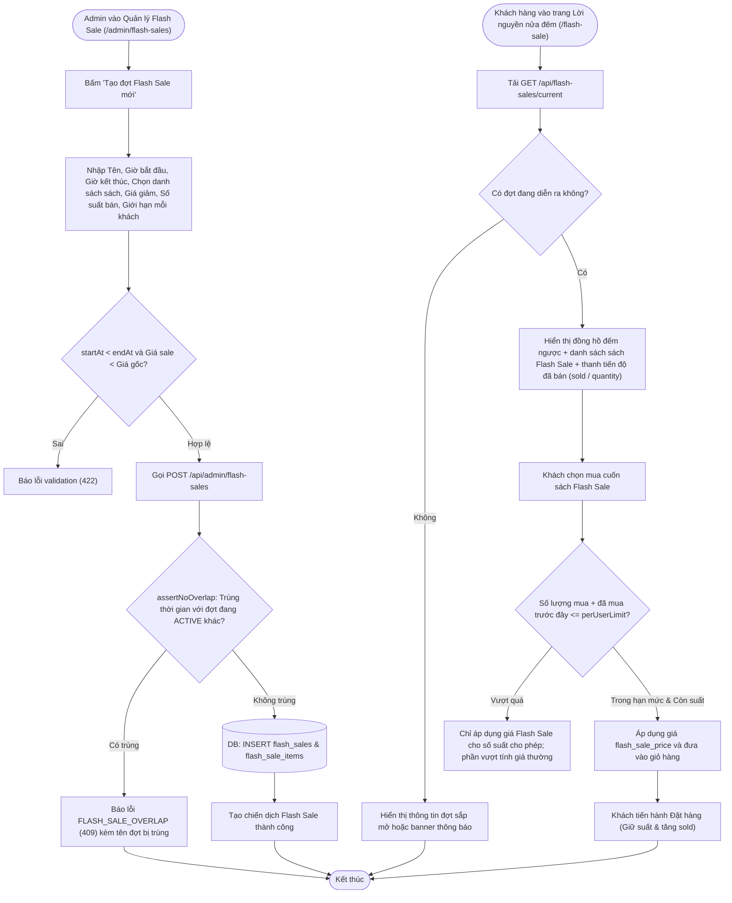

#### 4.2. Sơ đồ Tuần tự (Sequence Diagram) – Admin tạo chương trình Flash Sale & kiểm tra chồng chéo thời gian
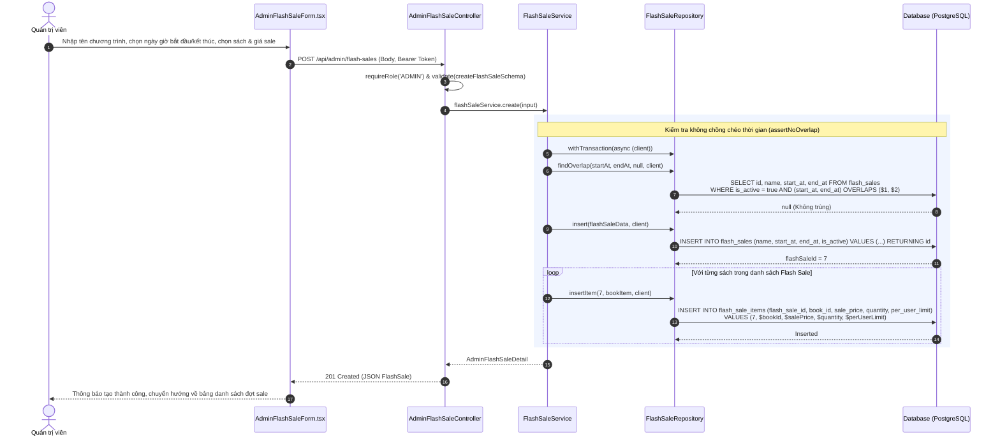

---

### CHỨC NĂNG 5: QUẢN LÝ SÁCH & TỒN KHO (ADMIN) (MODULE 02 - F03, MỤC 17 & 6 ADMIN)
*Tương ứng mục 17 & một phần mục 6 trong ghi chú.*

#### 5.1. Sơ đồ Hoạt động (Activity Diagram) – Quản trị Sách & Điều chỉnh/Nhập hàng Tồn kho
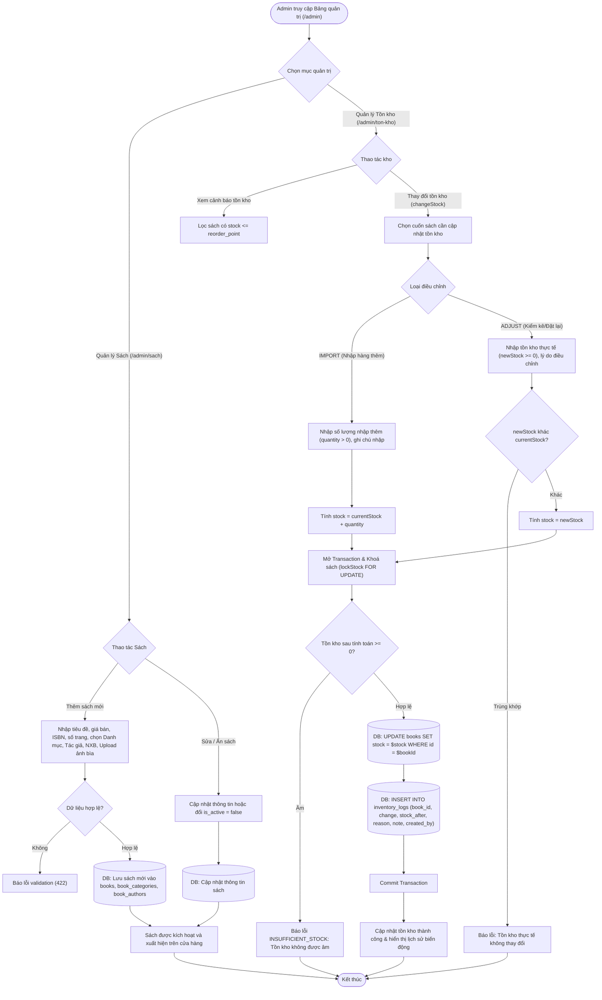

#### 5.2. Sơ đồ Tuần tự (Sequence Diagram) – Quá trình Nhập hàng & Ghi nhật ký biến động kho (Inventory Log)
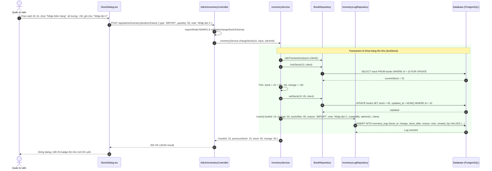

---

### CHỨC NĂNG 6: QUẢN LÝ KHÁCH HÀNG & ĐƠN HÀNG (ADMIN) (MODULE 08 - F13)
*Tương ứng mục 18 trong ghi chú.*

#### 6.1. Sơ đồ Hoạt động (Activity Diagram) – Xử lý Đơn hàng & Khoá tài khoản vi phạm
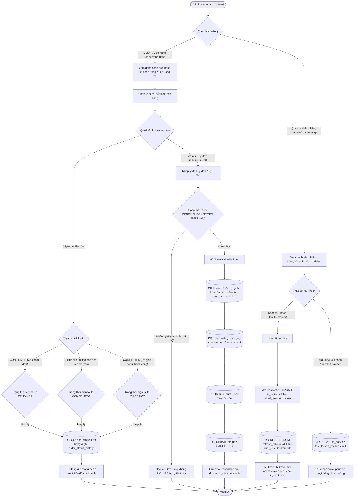

#### 6.2. Sơ đồ Tuần tự (Sequence Diagram) – Admin huỷ đơn hàng kèm hoàn trả tồn kho và voucher
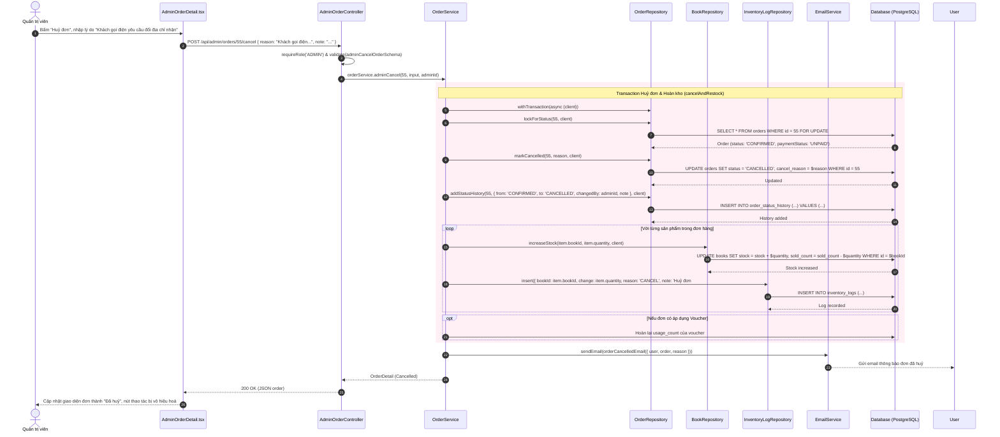

---

### CHỨC NĂNG 7: DASHBOARD & BÁO CÁO DOANH THU (ADMIN) (MODULE 14 - F19)
*Tương ứng mục 19 trong ghi chú.*

#### 7.1. Sơ đồ Hoạt động (Activity Diagram) – Xem Dashboard & Xuất Báo cáo CSV
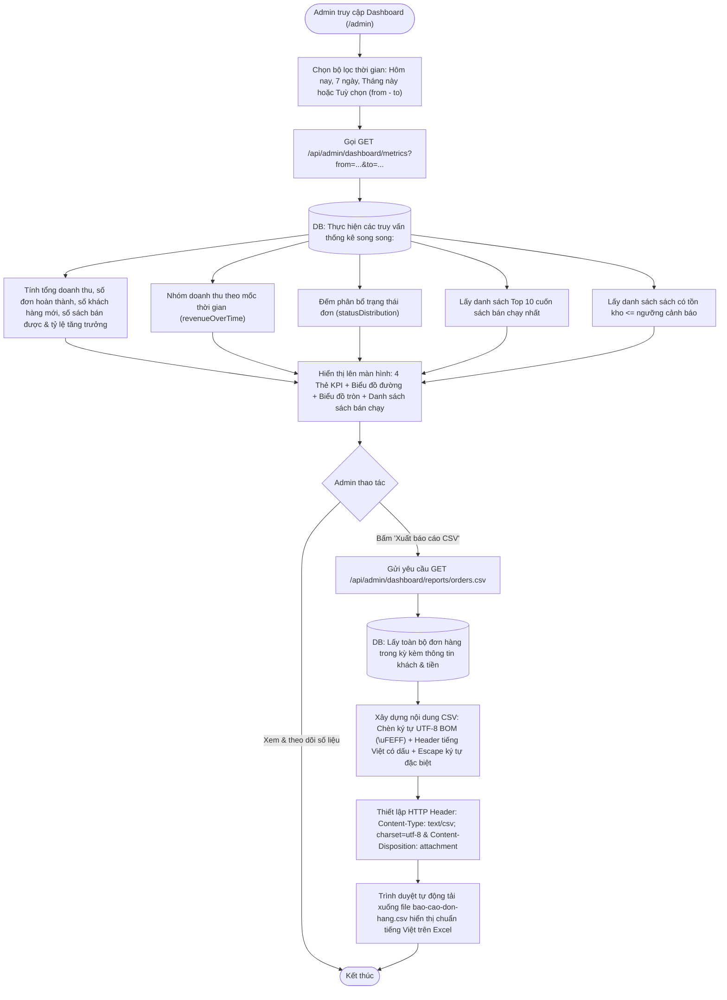

#### 7.2. Sơ đồ Tuần tự (Sequence Diagram) – Luồng xuất báo cáo đơn hàng định dạng CSV chống lỗi font Excel
```mermaid
sequenceDiagram
    autonumber
    actor Admin as Quản trị viên
    participant UI as DashboardHeader.tsx
    participant Ctrl as AdminDashboardController
    participant Svc as ReportService
    participant Repo as DashboardRepository
    participant DB as Database (PostgreSQL)

    Admin->>UI: Bấm nút "Xuất báo cáo", chọn khoảng ngày 01/10/2026 - 31/10/2026
    UI->>Ctrl: GET /api/admin/dashboard/reports/orders.csv?from=2026-10-01&to=2026-10-31
    Ctrl->>Ctrl: requireRole('ADMIN') & validate(reportQuerySchema)
    Ctrl->>Svc: reportService.exportOrdersReportCSV({ from, to }, res)
    
    Svc->>Repo: listOrdersForReport({ from, to })
    Repo->>DB: SELECT o.id, o.code, o.created_at, u.full_name, u.email, o.status,<br/>o.payment_method, o.total_amount, o.discount_amount, o.final_amount<br/>FROM orders o JOIN users u ON o.user_id = u.id WHERE o.created_at BETWEEN $1 AND $2
    DB-->>Repo: Danh sách 450 dòng đơn hàng
    Repo-->>Svc: orderRecords
    
    Note over Svc, Ctrl: Thiết lập header UTF-8 BOM tránh lỗi tiếng Việt trong Microsoft Excel
    Svc->>Ctrl: res.setHeader('Content-Type', 'text/csv; charset=utf-8')
    Svc->>Ctrl: res.setHeader('Content-Disposition', 'attachment; filename="bao-cao-don-hang-2026-10.csv"')
    Svc->>Ctrl: res.write('\uFEFF') (BOM Header)
    Svc->>Ctrl: res.write("Mã đơn,Ngày đặt,Khách hàng,Email,Trạng thái,Phương thức,Tổng tiền,Thành tiền\n")
    
    loop Duyệt qua từng dòng đơn hàng
        Svc->>Svc: formatRow(record) (escape dấu phẩy và ngoặc kép)
        Svc->>Ctrl: res.write(csvLine)
    end
    
    Svc->>Ctrl: res.end()
    Ctrl-->>UI: File stream tải về trực tiếp
    UI-->>Admin: Trình duyệt hoàn tất lưu file CSV về máy tính
```

---

### CHỨC NĂNG 8: AI GỢI Ý SÁCH THEO SỞ THÍCH (GROQ) (MODULE 15 - F20)
*Tương ứng mục 20 trong ghi chú ("AI nhưng chưa rõ ràng").*

#### 8.1. Sơ đồ Hoạt động (Activity Diagram) – Onboarding sở thích & Sinh gợi ý thông minh
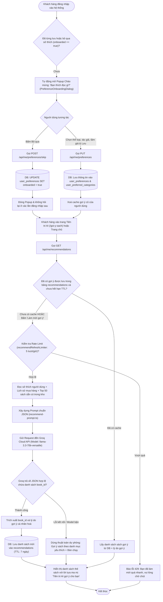

#### 8.2. Sơ đồ Tuần tự (Sequence Diagram) – Quy trình Gọi Groq AI sinh danh sách gợi ý cá nhân hoá
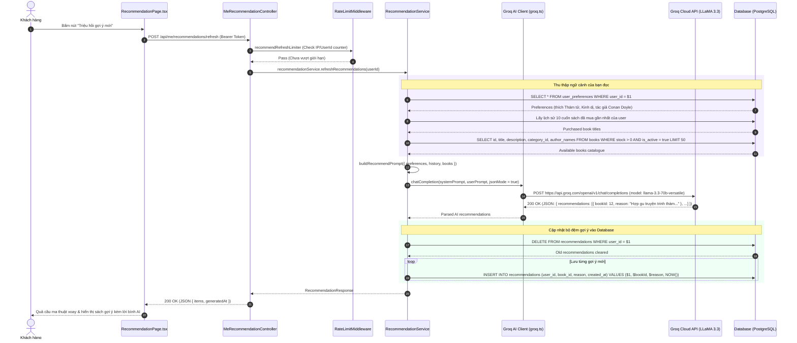

---

## PHẦN 3: TỔNG HỢP KIẾN TRÚC MÃ NGUỒN CỦA HƯƠNG TRONG DỰ ÁN

| Module | Tên Module | Controller & Service | Repository | Bảng Database liên quan |
|---|---|---|---|---|
| **M02** | Admin Books & Inventory | `admin/book.*`, `inventory.service.ts`, `category.service.ts` | `book.repository.ts`, `inventory-log.repository.ts` | `books`, `book_categories`, `book_authors`, `inventory_logs` |
| **M04** | User Profile & Address | `me.controller.ts`, `address.controller.ts`, `profile.service.ts`, `address.service.ts` | `user.repository.ts`, `address.repository.ts`, `refresh-token.repository.ts` | `users`, `user_addresses`, `refresh_tokens` |
| **M08** | Admin Customer & Orders | `customer.service.ts`, `order.service.ts` (admin functions) | `user.repository.ts`, `order.repository.ts` | `users`, `orders`, `order_items`, `order_status_history` |
| **M09** | Wishlist | `wishlist.controller.ts`, `wishlist.service.ts` | `wishlist.repository.ts` | `wishlists`, `books` |
| **M10** | Reviews | `review.controller.ts`, `review.service.ts` | `review.repository.ts` | `reviews`, `books`, `orders` |
| **M12** | Flash Sale | `flash-sale.controller.ts`, `flash-sale.service.ts` | `flash-sale.repository.ts` | `flash_sales`, `flash_sale_items`, `books` |
| **M14** | Admin Dashboard & Reports | `admin/dashboard.controller.ts`, `dashboard.service.ts`, `report.service.ts` | `admin/dashboard.repository.ts` | `orders`, `order_items`, `books`, `users` |
| **M15** | AI Recommendations | `preference.controller.ts`, `recommendation.controller.ts`, `preference.service.ts`, `recommendation.service.ts` | `preference.repository.ts`, `recommendation.repository.ts` | `user_preferences`, `user_preferred_categories`, `recommendations`, `books` |

---
*Tài liệu được khởi tạo và đối chiếu tự động với 100% mã nguồn thực tế của dự án BookStore.*
